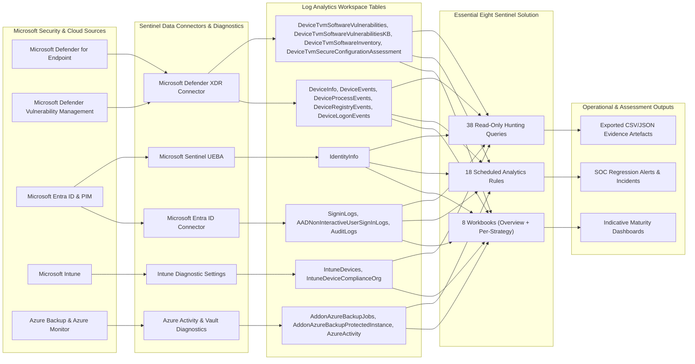
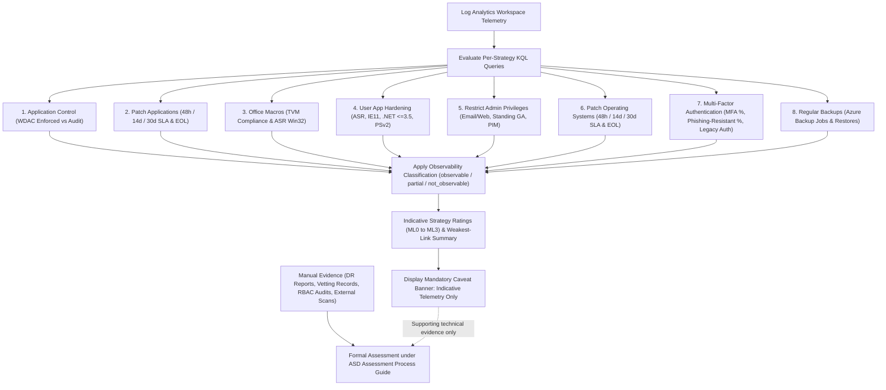
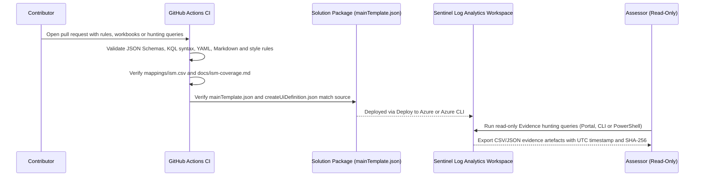

# Architecture and data flow

This document illustrates the Microsoft security data sources, Microsoft Sentinel data connectors, indicative maturity scoring pipeline and read-only evidence export workflow used by `essential-eight-sentinel`.

## 1. Data sources, connectors and Sentinel artefacts

The solution relies on native [Microsoft Sentinel data connectors](https://learn.microsoft.com/en-us/azure/sentinel/data-connectors-reference) and [Microsoft Defender XDR advanced hunting tables](https://learn.microsoft.com/en-us/defender-xdr/advanced-hunting-schema-tables). All analytics rules, workbooks and hunting queries are read-only against the Log Analytics workspace.

## 2. How indicative maturity scores are calculated

The overview workbook ([EssentialEight-Overview.json](../Solution/Workbooks/EssentialEight-Overview.json)) evaluates each of the eight mitigation strategies against thresholds derived from the [ASD Essential Eight Maturity Model (November 2023)](https://www.cyber.gov.au/resources-business-and-government/essential-cyber-security/essential-eight/essential-eight-maturity-model).

Strategies that depend on procedural or offline evidence (such as macro code vetting, annual WDAC ruleset reviews, initial privileged access approvals and offline backup restoration drills) are explicitly flagged and capped so telemetry scores are never mistaken for a formal assessment.

## 3. Read-only assessment evidence and CI packaging flow

Assessors query the workspace with read-only permissions (`Log Analytics Reader`), while GitHub Actions validates schemas, KQL syntax, ISM mappings and Content hub package generation on every pull request.

## Official references

- [ASD Essential Eight Maturity Model](https://www.cyber.gov.au/resources-business-and-government/essential-cyber-security/essential-eight/essential-eight-maturity-model)
- [ASD Essential Eight Assessment Process Guide](https://www.cyber.gov.au/resources-business-and-government/essential-cyber-security/essential-eight/essential-eight-assessment-process-guide)
- [Microsoft Sentinel data connectors reference](https://learn.microsoft.com/en-us/azure/sentinel/data-connectors-reference)
- [Microsoft Defender XDR advanced hunting schema tables](https://learn.microsoft.com/en-us/defender-xdr/advanced-hunting-schema-tables)

## Disclaimer

This is an independent community project. It is not produced, endorsed or supported by the Australian Signals Directorate (ASD), the Australian Cyber Security Centre (ACSC) or Microsoft.
