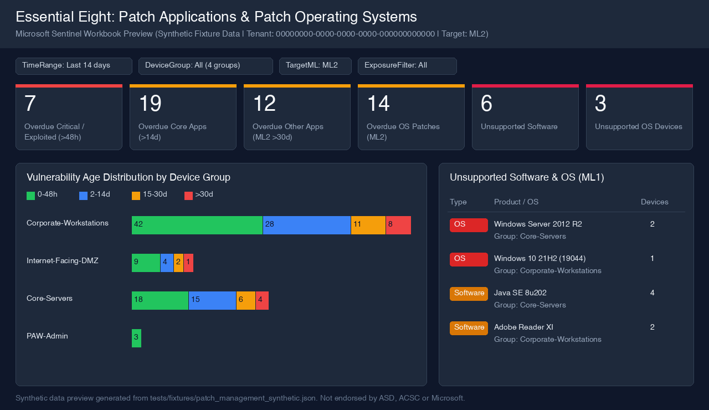
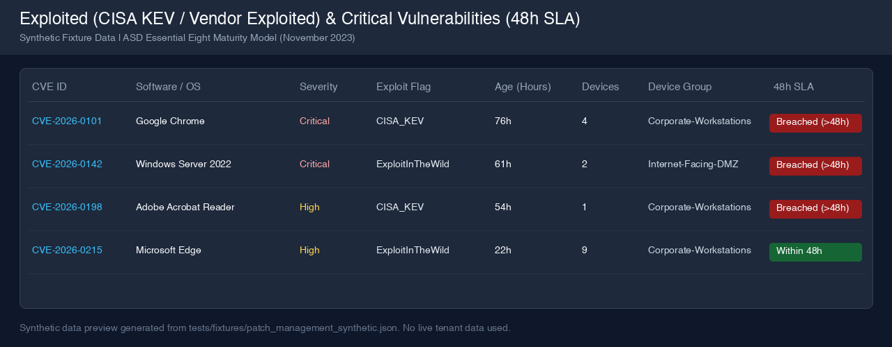

# Workbook: Patch applications and Patch operating systems

This workbook tracks vulnerability remediation timeframes, exploited vulnerabilities (CISA KEV and vendor-confirmed exploits) and unsupported software or operating systems against the [ASD Essential Eight Maturity Model (November 2023)](https://www.cyber.gov.au/resources-business-and-government/essential-cyber-security/essential-eight/essential-eight-maturity-model).

- **Workbook template:** [EssentialEight-PatchApplicationsAndOS.json](../../Solution/Workbooks/EssentialEight-PatchApplicationsAndOS.json)
- **Analytics rules:**
  - [E8-Patch-ExploitedVulnOverdue48h.yaml](../../Solution/Analytic%20Rules/E8-Patch-ExploitedVulnOverdue48h.yaml)
  - [E8-Patch-UnsupportedOSDetected.yaml](../../Solution/Analytic%20Rules/E8-Patch-UnsupportedOSDetected.yaml)

## Required Microsoft Sentinel data tables

- `DeviceTvmSoftwareVulnerabilities` ([Microsoft Learn](https://learn.microsoft.com/en-us/defender-xdr/advanced-hunting-devicetvmsoftwarevulnerabilities-table))
- `DeviceTvmSoftwareVulnerabilitiesKB` ([Microsoft Learn](https://learn.microsoft.com/en-us/defender-xdr/advanced-hunting-devicetvmsoftwarevulnerabilitieskb-table))
- `DeviceTvmSoftwareInventory` ([Microsoft Learn](https://learn.microsoft.com/en-us/defender-xdr/advanced-hunting-devicetvmsoftwareinventory-table))
- `DeviceInfo` ([Microsoft Learn](https://learn.microsoft.com/en-us/defender-xdr/advanced-hunting-deviceinfo-table))

## Maturity Level timeframes implemented

| Category | Maturity Level 1 | Maturity Level 2 | Maturity Level 3 |
| :--- | :--- | :--- | :--- |
| Online services (critical or exploited) | 48 hours | 48 hours | 48 hours |
| Online services (non-critical) | Not specified (ML2+) | 2 weeks | 2 weeks |
| Core user applications (browsers, Office, PDF, email, security) | 2 weeks (48 hours if exploited) | 2 weeks (48 hours if exploited) | 2 weeks (48 hours if exploited or critical) |
| Other applications | Not specified (ML2+) | 1 month | 2 weeks (48 hours if exploited) |
| Internet-facing operating systems | 48 hours (critical/exploited) | 48 hours (critical/exploited), 2 weeks (other) | 48 hours (critical/exploited), 2 weeks (other) |
| Workstation and server operating systems | 1 month (48 hours if exploited) | 1 month (48 hours if exploited) | 2 weeks (48 hours if critical or exploited) |
| Unsupported software and operating systems | Removed / replaced | Removed / replaced | Removed / replaced |

## Parameters and filtering

- **Time range** (`TimeRange`) - Selects the observation window for trend views.
- **Device group** (`DeviceGroup`) - Dynamically populated from `DeviceInfo.MachineGroup` so teams can filter by workstation, DMZ, server or PAW device groups.
- **Target maturity level** (`TargetML`) - Adjusts SLA breach thresholds between ML1, ML2 and ML3.
- **Device exposure** (`ExposureFilter`) - Filters all devices, internet-facing devices only (`IsInternetFacing == true`) or internal-only devices.

## Synthetic data previews

The screenshots below are rendered from synthetic fixture data in `tests/fixtures/patch_management_synthetic.json` (no live tenant data).

## Disclaimer

This is an independent community project. It is not produced, endorsed or supported by the Australian Signals Directorate (ASD), the Australian Cyber Security Centre (ACSC) or Microsoft.
